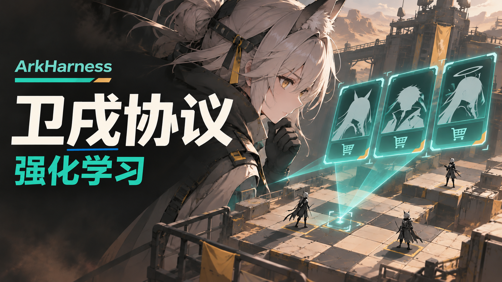

明日方舟「卫戍协议」规程Harness。Windows + MuMu + MaaFramework。

还不算非常完整，目前只按照自己的需求完善了模板，接入其他模型可以修改调用点`live.py`
## 首次准备

需要 MuMu、ADB、Node.js、uv。PowerShell 中将以下路径换成本机路径。

```powershell
uv venv --python 3.12
uv pip install -r requirements-screen.txt
uv pip install torch --index-url https://download.pytorch.org/whl/cpu

$env:ARK_ADB = 'D:\ADB\platform-tools\adb.exe'
$env:ARK_MUMU = 'D:\Program Files\Netease\MuMu'
$env:ARK_ENGINE = 'E:\ArkHarness-engine\sp-label'
$env:ARK_CATALOG = 'E:\ArkHarness-data\act3autochess-v3_1'
$env:ARK_P7 = 'E:\ArkHarness-data\P7-model-final.pt'

node tools/export_catalog.mjs
```

把 PP-OCRv6 small 的 `det.onnx`、`rec.onnx`、`keys.txt` 放进 `resource/model/ocr/`。已有匹配的 `data/catalog.json` 可跳过导出。

放好 OCR 文件后生成数字专用识别资源。更新原始 OCR 模型后重新运行这一步。

```powershell
uv run --with onnx python tools/build_digit_ocr.py
```

## 启动

MuMu 设为 1280×720，进入「卫戍协议」入口。

新开局优先加载 `models/P14-model-81M.pt`，缺少该文件时使用 `ARK_P7` 指向的检查点。可用 `--policy` 指定新局模型，续档沿用存档中的模型。

```powershell
& $env:ARK_ADB connect 127.0.0.1:16384

$run = '.\.venv\Scripts\python.exe'
& $run -X utf8 -m harness.live --probe              # 检查连接和模型
& $run -X utf8 -m harness.live --new --mode auto    # 开新局
& $run -X utf8 -m harness.live --resume --mode auto # 续跑
```

布阵后停下用 `--mode confirm --stop-after-layout`。日志在 `logs/live/`。

```powershell
& $run -X utf8 -m tools.collect_shop_portraits --resume --mode auto --adb-address 127.0.0.1:16384
```
